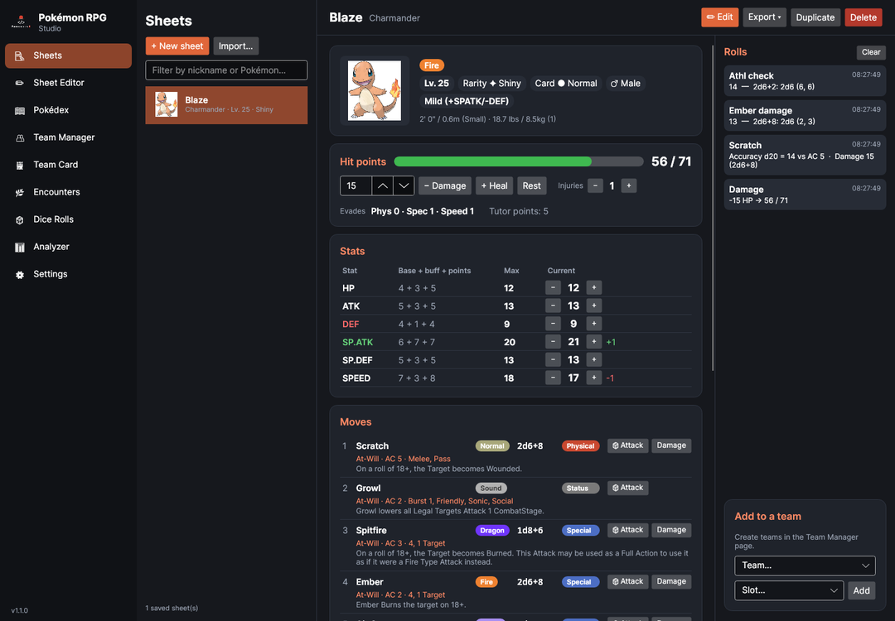
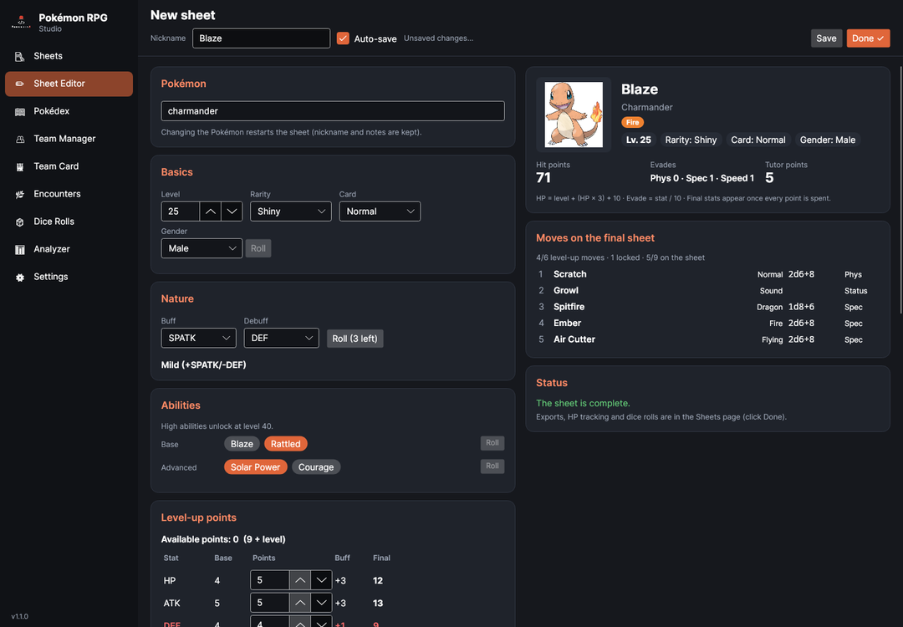
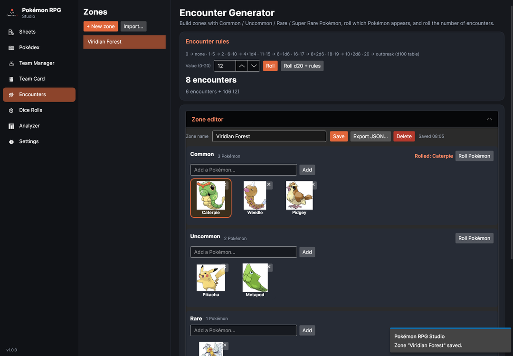
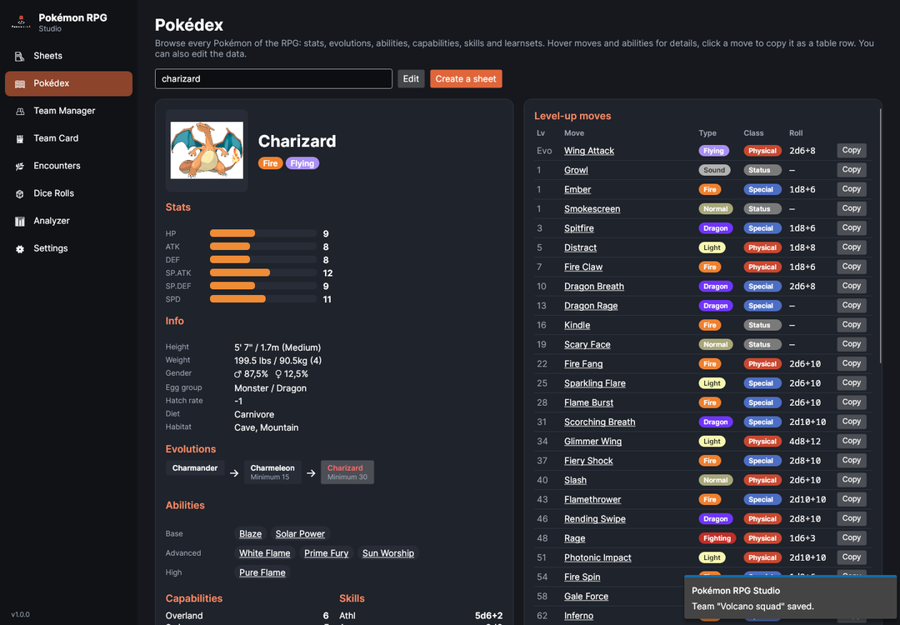
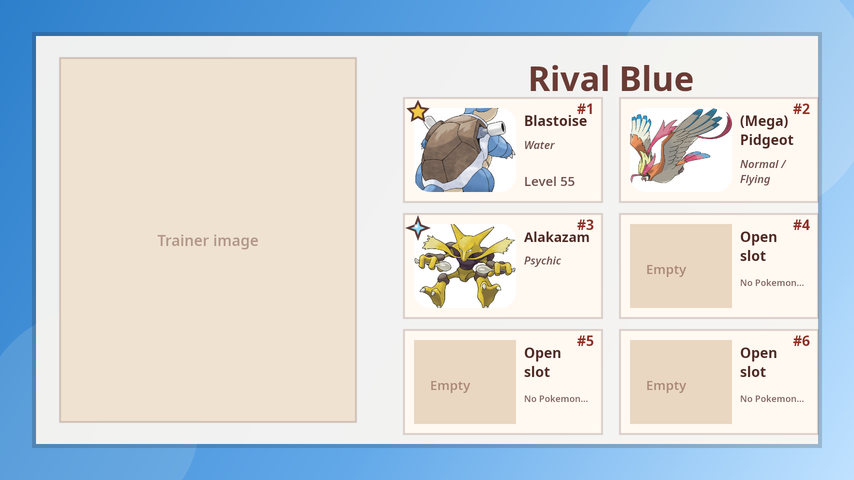

# Pokémon RPG Studio

A cross-platform desktop application (Linux & Windows) for the tabletop Pokémon RPG tools of the
FaeresDev website. It brings every feature of the website's **Pokémon RPG tools** section to a native
app written in **C# / .NET 10 / Avalonia UI**, and adds what the website could not do without its
server: **sheets are saved on your computer and can be reopened and edited at any time**.



- [Features](#features)
- [How it works](#how-it-works)
- [Installation](#installation)
- [Building from source](#building-from-source)
- [Scripts reference](#scripts-reference)
- [Project structure](#project-structure)
- [Release notes](#release-notes)

---

## Features

| Page | Website equivalent | What it does |
|------|--------------------|--------------|
| **Sheets** | — | Two views, switched at the top of the page: **List view** (library of saved sheets and the sheet in use: HP, injuries and current stats tracking, attack / skill rolls, exports, teams) and **Database view** (every saved sheet in one sortable, filterable table). |
| **Sheet Editor** | Pokemon Generator | Create a sheet or change an existing one (level, nature, abilities, points, moves…). |
| **Pokédex** | Pokemon Sheet | Browse every Pokémon of the RPG and edit its data. |
| **Moves** | — | Every move, filtered by name / effect, type, class, frequency or learner, sortable by any column. |
| **Abilities** | — | Every ability, filtered by name / effect, frequency or Pokémon, sortable; who has each one. |
| **Teams** | Pokemon Team Manager | Group up to six saved sheets into a team and export a PNG team card. |
| ↳ Team Card | Pokemon Team Card | Opened with the *Card for any team…* button: build a card for any team (rivals, NPCs…) without saving anything. |
| **Encounters** | Pokemon Encounter Generator | Build zones by rarity (sorted in folders), roll Pokémon and encounter counts. |
| **Shops** | — | Stock of your marts and merchants: items with a name, quantity, price, optional picture and effect; JSON export / import. Two views: |
| ↳ Shop view | — | The selected shop's items as cards (picture, price, stock; sold-out items greyed). |
| ↳ Edit | — | Create, rename, duplicate, delete, import and export shops, and edit their items. |
| **Tools** | — | Four tools, one at a time, switched at the top of the page: |
| ↳ Dice Rolls | Pokemon Dice Rolls | Encounter, capture, shiny and card rolls, plus a free dice-expression roller. |
| ↳ Type Chart | — | Type effectiveness of the 21 types (18 official + Light, Data, Sound) and the damage taken by any single or dual type. |
| ↳ Analyzer | Pokemon Analyzer | Number of learnable moves of each type for a Pokémon. |
| ↳ Whiteboard | — | Draw battle maps and positions: pen, shapes, arrows, texts, images and Pokémon tokens on a grid. |
| **Settings** | — | Theme, export options, data folders, import from the website. |

### Sheets (using a sheet)
The sheets you saved, shown as a ready-to-play character sheet. Pick one in the list on the left;
the list can be filtered and **sorted** by nickname, Pokémon, level, rarity, last update or creation
date (↑/↓ switches the direction; the choice is remembered).
- Identity: sprite, types, level, rarity, card, gender, nature, size, and the **damage taken** from
  each attacking type (weaknesses ×2 / ×4, resistances ×0.5 / ×0.25, immunities ×0, read from the
  type chart; neutral ×1 types are not listed).
Everything that changes during a session is done from this page and saved with the sheet:
- **Hit points** bar with damage / heal buttons, a **temporary max HP** bonus / malus (+ Max HP /
  − Max HP, removable with ✕ temp) and a **Rest** button (HP back to the max, every temporary
  change removed — injuries and notes are kept). HP can go below 0; Pokémon at 0 HP or less are flagged fainted.
- **Injuries**: markers sit every 25 % of the sheet max HP below the max — 75 %, 50 %, 25 %, 0,
  −25 %… (temporary max HP changes don't move the step). Damage that reaches or passes a marker gives
  one injury per marker, and a single hit of more than 50 % of the max HP (massive damage) gives one
  more. Each injury lowers the max HP by a tenth (rounded down). Healing (and Rest) never removes
  injuries: they are removed by hand with the − button, and passing a marker again after healing
  gives a new injury. The sheet shows the injuries, the next marker and the reduced max HP
  (`Max HP 83 +10 temp − 19 (2 injuries) = 74`); the log says when an injury is gained or removed.
  Injuries from other sources can be added by hand with the + button.
- **Stats**: base + buff + points = sheet value, and a **current** value with a temporary bonus /
  malus (− / +) used for damage, evades and custom rolls; "Clear temp bonuses" resets them.
- **Moves**: **Disable / Enable** a move for a while (Disable, Torment, no PP…): it is greyed out,
  marked DISABLED and can't be rolled; "Enable all" brings them back.
- **Skills**: a temporary bonus / malus (− / +) per skill, added to its roll (`2d6+2` → `2d6+2+1`).
- **Session notes** under every section (hit points, stats, moves, abilities, skills, capabilities),
  saved automatically.
- **Moves**: the move table of the sheet (a line separates the first 6 moves from the next ones)
  with **🎲 Attack** and **Damage** buttons. Attack rolls the accuracy d20 against the move's AC;
  **a 20 is a critical hit: twice as many damage dice** (`2d8+10` → `4d8+10`). Damage = move roll (STAB already in the
  damage base) **+ ATK for physical moves / + SP.ATK for special moves** (current value).
- **Custom roll**: type your own AC and damage expression, pick any number of stats to add
  (e.g. ATK + SPEED, current values), and roll the attack, the accuracy only or the damage only
  (with an optional forced critical). Each stat is added once, even on a critical hit.
- **Skills** with a roll button. Every result goes into the **Rolls** log.
- Abilities with their full effect, capabilities, egg / TM / tutor moves and notes.
- HP, injuries and current stats are saved with the sheet (and kept when the sheet is edited).
- **Edit** (opens the Sheet Editor), **Export** (Google Docs, Markdown, HTML, sheet file),
  **Duplicate**, **Delete**, **Add to a team**, **Import** sheet files.
- Shortcuts: `Ctrl+N` new sheet, `Ctrl+E` edit the displayed sheet.

### Sheet Editor (building a sheet)
- Searchable selection among the 2,100+ Pokémon of the RPG, with sprite and type badges.
- Level (1–150), rarity (Normal / Shiny / Platine), card (None / Normal / Shiny / Platine), gender
  (pick, or roll with the species gender ratio; genderless species are detected automatically).
- Nature: choose the buffed and lowered stats, or roll them (3 rolls per sheet, like the website).
  Every rolled nature is kept with the sheet: click any of them to use it (the one in use is
  highlighted), so you can keep your favourite instead of the last roll.
- Abilities by tier: Base (any level), Advanced (level 20+), High (level 40+) and custom sections
  (level 10+). Several can be selected per tier; each tier has a **Roll** button. Hover an ability
  to read its effect.
- **Extra** abilities: *Add…* opens a searchable list of every ability of `abilities.json`;
  tick several and click *Add selected* to give them to the Pokémon on top of its own list (or add
  a homebrew name typed in the search box). Click an extra ability to remove it. They are exported
  with the others and never reported as errors.
- Level-up points: `9 + level` points to distribute, with an **Auto** button that spreads them
  proportionally to the base stats. Buffs and final stats are shown live (buffed stat in green,
  lowered stat in red).
- Moves: as many level-up moves as you want (only those known at the current level are proposed;
  a line marks the end of the first 6), plus egg, tutor and TM moves. Egg / tutor / TM moves can be
  **locked** to put them on the move table too.
  Every move has a **DB buff** (0–20) and its roll is recomputed with STAB and the buff.
- Live preview: hit points, evades, tutor points, the exact move list of the final sheet and what
  is still missing.
- **Tutor points**: one every 5 levels (0 before level 5), with − / + buttons to spend or add points by
  hand (the total never goes below 0; *Reset* goes back to the level ones) and **tutor notes** written
  under them. Both are shown on the Sheets page and in the exports.
- Free notes, appended to the exported sheet.
- **Save / auto-save** (as soon as a nickname is set), `Ctrl+S`; **Done** saves and goes back to
  the sheet in the Sheets page.



### Pokédex
- **Damage taken** by the Pokémon's types (weaknesses, resistances, immunities; ×1 left out).
- Stats with bars, height, weight, gender ratio, egg group, hatch rate, diet, habitat.
- Evolution chain with branches; click a stage to open it.
- Abilities, capabilities, skills, mega evolution (types, ability, stat changes, sprite).
- Level-up moves table (type, class, roll) with move details on hover; TM, tutor and egg moves.
- **Copy** a move as a table row (pastes as a row in Google Docs / Sheets, TSV as plain text).
- **Edit** any Pokémon (stats, info, types, evolutions, abilities, capabilities, skills, all
  learnsets). Edits are saved to your own copy of the data and can be reset from Settings.
- **Create a sheet** for the displayed Pokémon in one click.

### Moves & Abilities
- **Moves**: the whole `moves.json` as a table (name, type, class, frequency, AC, damage base, roll,
  range, number of Pokémon that learn it).
  - Filters: text search on the name (optionally also in effects and ranges), type, class,
    frequency, and **Learnable by** a Pokémon (level-up, evolution, TM, tutor and egg moves).
  - Click any column title to sort by it; click again to reverse. Moves without a value (no AC,
    status moves for DB) always come last. The sort is remembered.
  - Selecting a move shows its full details, a **Copy** button (table row, like the Pokédex) and
    every Pokémon that learns it, grouped by how (with levels). Click a Pokémon to open it in the
    Pokédex.
- **Abilities**: the whole `abilities.json` (name, frequency, effect summary, number of Pokémon).
  - Filters: text search (optionally in effects), frequency (Static, At-Will, Scene, Daily…),
    abilities of a given Pokémon, and "only abilities a Pokémon has".
  - Sort by name, frequency or number of Pokémon.
  - Selecting an ability shows its full text, a **Copy** button and the Pokémon that have it,
    grouped by tier (Base, Advanced, High, Mega, custom sections).
- Frequencies are grouped across spellings (`Daily x1` → Daily, `2x Daily` → Daily x2, `At Will -
  Free Action` → At-Will) and sorted from most to least usable.
- Both pages read the live data files: after updating `moves.json` / `abilities.json` /
  `pokemon.json` (or editing a Pokémon) the lists are rebuilt automatically.

### Team Manager & Team Card
- Six slots per team, filled from your saved sheets (level and rarity follow the sheet), mega toggle.
- Themed card (21 type themes) with a trainer image, exported as a 1708 × 960 PNG with sprites,
  types, levels and shiny / platine markers.
- Teams auto-save and remember their trainer image.
- The **Team Card** (button *Card for any team…* on the Teams page, *← Back to teams* to return) builds the same card from any Pokémon without saving anything.

### Encounters
- Zones with Common / Uncommon / Rare / Super Rare sections; add Pokémon with sprites, remove them.
- **Roll Pokémon** in a section (highlights the result).
- Encounter rules: enter a value 0–20 (or roll a d20) to get the number of encounters, including
  the outbreak d100 table.
- Zones auto-save; import / export the website's zone JSON format.
- Folders (nested, like sheets): pick the folder shown above the zone list, create / rename / delete
  folders, and move a zone with the folder picker next to its name. New and imported zones go into
  the folder shown.



### Dice Rolls
- Encounter rolls (d100 bracket + d20 count) and capture rolls (d20 accuracy + d100 rate).
- Expression roller (`2d6+1d8+4`, `(1d20+5)*2`) with the detail of every die.
- Shiny rolls with your shiny number and Dexnav reroll window.
- Card rolls with three normal, two shiny and one platine number, card Dexnav and the extra
  batches for shiny / platine Pokémon.
- Your numbers are remembered between sessions.

### Whiteboard
A board for the game table: battle maps, positions, routes, notes. Saved automatically.
- Tools: **Select** (move, resize with the corner square, double-click a text to edit it), **Pen**,
  **Eraser** (click or drag over items), **Line**, **Arrow**, **Rectangle**, **Ellipse** (Shift: straight
  lines at 45° steps, squares, circles) and **Text**.
- 10 colours, 3 sizes and a see-through **Fill** for rectangles and ellipses (areas, zones of effect).
  Changing them with an item selected changes the item.
- **Image…** adds a picture (map, character…; copied into the whiteboard folder) and the Pokémon box
  adds a **token** with the Pokémon's sprite. Images keep their proportions when resized.
- **To front / To back** to put a map under the tokens, **Delete** (or the Delete key).
- Optional square **grid**; mouse wheel zooms, right / middle drag (or dragging the empty board with
  Select) pans, **Fit** shows everything.
- **Undo / Redo** (Ctrl+Z, Ctrl+Y), **Clear**, **Export PNG**.

### Shops
The stock of the marts and merchants of your game, in its own section of the sidebar. Saved automatically.
- **Shop view** shows the selected shop like a catalogue: one card per item with its picture, price and
  stock (sold-out items are greyed). **Edit this shop** opens the edit view on the same shop.
- **Edit**: any number of shops, listed on the left: **+ New shop**, rename, **Duplicate**, **Delete**.
- Each item has a **name**, a **quantity** and a **price** (all required), an optional **effect** (free
  text, shown on the item's card) and an optional **picture**
  (click the picture square; the file is copied into the shops folder). The header sums the items,
  the units in stock and the stock value.
- **Export shop…** / **Export all…** write a `.json` file with the pictures embedded, so it can be
  imported on another computer. **Import…** adds the shops of a file: an export, a single shop
  (`{"name": "…", "items": [ … ]}`) or a plain list of items (the shop takes the file's name).
  Items missing a name, quantity or price are skipped and listed.

```json
{ "name": "Pewter Mart", "items": [
  { "name": "Potion", "quantity": 10, "price": 300 },
  { "name": "Poké Ball", "quantity": 5, "price": 200, "effect": "Catches a wild Pokémon.", "picture": "data:image/png;base64,…" }
] }
```

| Pokédex | Team card export |
|---|---|
|  |  |

---

## How it works

### Rules implemented (identical to the website)

| Rule | Formula |
|------|---------|
| Level-up points | `9 + level`, all must be spent before export |
| Automatic stat bonus | card (None 0, Normal +1, Shiny +2, Platine +3) + rarity (Normal 0, Shiny +2, Platine +4) on every stat |
| Nature | lowered stat −2; buffed stat +2, raised to 4 / 5 / 4 by a Normal / Shiny / Platine card when the nature is not neutral |
| Final stat | `base + automatic bonus + level-up points` (never below 0) |
| Hit points | `level + 3 × HP + 10` |
| Injuries | 1 per 25 % of max HP lost (HP ≤ 75 %, ≤ 50 %, ≤ 25 %, ≤ 0…), healed back automatically; +1 for a hit of more than 50 % of max HP (massive damage, not healed by HP); each lowers the max HP by 1/10 |
| Evades | Physical = DEF / 10, Special = SP.DEF / 10, Speed = SPD / 10 (rounded down) |
| Tutor points | `level / 5` (rounded down) + points added / removed by hand in the editor (never below 0) |
| Move roll | damage base + 2 if STAB (move shares a type with the Pokémon) + DB buff, converted with the damage-base table (`DB 6 = 2d6+8`…) |
| Damage roll | move roll + ATK (physical move) or SP.ATK (special move); status moves have no damage |
| Critical hit | accuracy d20 = 20: the damage roll uses twice as many dice (`2d8+10` → `4d8+10`); flat bonus and stat added once |
| Sheet move table | chosen level-up moves (no limit) then locked egg / TM / tutor moves; a 2nd table starts at row 7; exports have at least 9 rows |
| Egg moves | a Pokémon without egg moves uses the egg moves of the first form of its evolution line |

All the rules live in `src/PokemonRpgStudio.Core/Rules/SheetRules.cs` and are covered by unit tests
(including a run over every Pokémon of the database, ported from the website's
`tests/pokemon-generator.test.mjs`).

### Where your data is stored

| Platform | Folder |
|----------|--------|
| Linux | `~/.local/share/PokemonRpgStudio/` |
| Windows | `%LOCALAPPDATA%\PokemonRpgStudio\` |
| Android | the app's private storage (removed when the app is uninstalled: export what you want to keep) |

```
PokemonRpgStudio/
├── sheets/<id>.json     one file per Pokémon sheet (names only, + play state: HP, injuries, temp bonuses, disabled moves, notes)
├── teams/<id>.json      one file per team
├── zones/<id>.json      one file per encounter zone
├── whiteboard/          board.json + images/ (pictures added to the whiteboard)
├── shops/               shops.json + images/ (pictures of the shop items)
├── data/                pokemon.json, moves.json, abilities.json + images/ — the game data the app reads
└── settings.json        theme, export URL, dice numbers
```

Set the `POKEMON_RPG_STUDIO_HOME` environment variable to use another folder (e.g. a synced folder).
The **Settings** page has a button to open this folder.

### Importing Markdown sheets from the website
The `.md` files made by the website's **Generate Markdown** button can be imported (Sheets →
**Import…**, or Settings → Import, files or whole folders). The sheet is rebuilt from the file:
Pokémon, card, gender, nature, level, rarity, abilities (tier found in the Pokédex), level-up points
(from the `base+buff+points=final` formulas), level-up moves in table order, locked egg / TM / tutor
moves, DB buffs (roll higher than the damage base + STAB) and the free notes. The nickname is taken
from the title when present (`# Charmander — Blaze`), otherwise the Pokémon's name is used. Anything
that couldn't be matched (unknown ability or move, points that don't add up) is listed after the import.

### Compatibility with the website
The files use exactly the same JSON format as the website server (`server/pokemon_cards`,
`server/teams`, `server/zones`). In **Settings → Import from the website**, pick the website's
`server/` folder to import every sheet, team and zone at once (ids are kept, so teams still point to
their sheets). Sheet files exported from the app can be copied back to `server/pokemon_cards/`.

### Game data (pokemon.json, moves.json, abilities.json and the sprites)
The game data is **never inside the application**. The three JSON files and the sprites are plain
files in your data folder, and the application always reads them from there:

| Platform | Data folder |
|----------|-------------|
| Linux | `~/.local/share/PokemonRpgStudio/data/` |
| Windows | `%LOCALAPPDATA%\PokemonRpgStudio\data\` |
| Any | `$POKEMON_RPG_STUDIO_DATA` when set |

```
data/
├── pokemon.json
├── moves.json
├── abilities.json
├── type_chart.json  type effectiveness (optional: written with the built-in chart when missing)
└── images/          sprites, named like the website: charizard.png, charizard_mega.png, nidoran_(f).png…
```

You can edit or replace them at any time (then **Settings → Game data → Reload data**, or restart).
Application updates never touch them. Sheets only store **names** (moves, abilities, Pokémon), so
every sheet always shows the current data — e.g. a new damage base in `moves.json` changes the
rolls of existing sheets. Pokédex edits are written to the same `pokemon.json`.

Sprites can be added or replaced the same way: drop image files (png, jpg, jpeg, webp) in
`data/images/` — the file name decides the Pokémon — or use **Settings → Game data → Add / replace
sprites…**. A Pokémon without a sprite is simply shown without image.

**Default data.** Every package carries a default copy of the data (the JSON files, `images/` and a
`data-version.txt` stamp holding the SHA-256 of each file). It fills the data folder the first time and adds
any missing sprite at each start. When the shipped data changes (new version, AppImage updated by
Gear Lever…), the application **replaces** `pokemon.json`, `moves.json`, `abilities.json`,
`type_chart.json` and the shipped sprites on its next start. Sprites that only exist in your folder
are kept, and sheets, teams, zones and settings are never touched. Your Pokédex edits are kept until
the shipped data changes.

| Package | Default copy |
|---------|--------------|
| Linux folder / `.tar.gz`, Windows folder / `.zip` | `DefaultData/` beside the executable |
| AppImage | inside the AppImage: it works alone (Gear Lever, AppImageLauncher, any folder) |
| `install.sh`, `install.ps1`, setup wizard | copy the defaults into your data folder and **replace** `pokemon.json`, `moves.json`, `abilities.json`, `type_chart.json` and the sprites of an existing installation (sprites you added are kept; sheets, teams, zones and settings are never touched). `--keep-data` / `-KeepData` only adds the missing files |

If no default copy is found (e.g. a development build without data), the application opens a **Game data
needed** window to pick the three files or the folder that contains them (for instance the
website's `server/pokemon_data/`). The defaults are taken at build time from the website repository
(`server/pokemon_data/*.json`), through the `pokemon_data/` folder (a link) at the root of this project.

**Settings → Game data** shows the data folder, the size and date of each file, and can:
- **Install updated data files…** — pick a newer `pokemon.json`, `moves.json` and/or `abilities.json`;
  each file is checked before it replaces yours, then loaded;
- **Reload data** — read the files again after editing or replacing them by hand;
- **Open data folder**;
- **Restore default data** — replace the three files and the default sprites with the copies delivered
  with the application (sprites you added are kept);
- **Add / replace sprites…** and **Open sprites folder**.

`PokemonRpgStudio --check` prints the data and sprites folders and what was loaded, or which files are
missing. At build time, other default data can be used with
`POKEMON_DATA_DIR=… POKEMON_IMAGES_DIR=… ./scripts/build.sh`; at run time,
`POKEMON_RPG_STUDIO_IMAGES` points to another sprites folder.

**Type chart.** `type_chart.json` lists the types (`types`, display order) and, for each defending
type, the multiplier of each attacking type (`damage_taken.<defending>.<attacking>`: 0 no effect,
0.5 not very effective, 1 neutral, 2 super effective; a missing value is 1). Dual types multiply.
It is created with the built-in chart the first time, can be edited, installed (Settings → Install
updated data files…) or restored like the other files, and is shown in **Tools › Type Chart**.

Exported Markdown / Google Docs sheets reference the sprite on the website
(`https://faeresdev.site/images/<pokemon>.png`); the base URL can be changed in Settings.

---

## Installation

Release packages are produced by the build scripts in `dist/`.

### Linux
- **AppImage** (any distribution): `PokemonRpgStudio-<v>-x86_64.AppImage` (≈ 140 MB, game data
  included). `chmod +x` it and run it, or open it with **Gear Lever**: install and update it
  there like any AppImage. The data is copied to your data folder on the first start and
  refreshed automatically when an updated AppImage brings new data.
- **Executable**: extract `PokemonRpgStudio-1.2.0-linux-x64.tar.gz` and run `./PokemonRpgStudio`.
- **Install** (menu entry, icon, `pokemon-rpg-studio` command), from the repository:
  ```bash
  ./scripts/install.sh                 # newest AppImage (or executable folder) in dist/, for the current user
  ./scripts/install.sh --folder dist/PokemonRpgStudio-1.2.0-linux-x64
  sudo ./scripts/install.sh --system   # /opt + /usr/local for every user
  ./scripts/install.sh --keep-data     # don't replace your data files (by default they are updated)
  ./scripts/install.sh --uninstall     # your sheets and data files are kept
  ```
  or run `./install.sh` from inside an extracted release folder.

### Windows
- **Setup wizard** (recommended): `PokemonRpgStudio-1.2.0-win-x64-setup.exe`, built by
  `scripts\build.ps1` on Windows when Inno Setup 6 is installed. Installs for the current user
  (Start menu, optional desktop shortcut, entry in *Installed apps*), no administrator rights.
- **Portable**: extract `PokemonRpgStudio-1.2.0-win-x64.zip` and run `PokemonRpgStudio.exe`
  (keep it with the DLLs and `DefaultData\` beside it).
- **Install from the zip** (same result as the wizard): right-click `install.ps1` in the extracted
  folder → *Run with PowerShell*, or
  ```powershell
  powershell -ExecutionPolicy Bypass -File install.ps1
  powershell -ExecutionPolicy Bypass -File install.ps1 -Uninstall
  ```

### Android (phones, tablets, foldables)
- **APK**: `PokemonRpgStudio-<v>-android.apk` (≈ 145 MB, game data included), for Android 7.0 or newer
  (arm64 phones and tablets, x86_64 emulators / Chromebooks). Copy it to the device and open it; allow
  *Install unknown apps* for the app you open it with (Files, browser…) when Android asks. Or, with USB
  debugging enabled: `tools/android-sdk/platform-tools/adb install -r dist/PokemonRpgStudio-<v>-android.apk`.
- The first start copies the game data and sprites into the app's storage (a few seconds); updates that
  bring new data refresh it, like on the desktop.
- The layout adapts to the width of the screen, and follows it live when a foldable is folded / unfolded,
  rotated or used in split screen:
  - **narrow** (phone, folded foldable): a top bar with a ☰ menu; list + details pages show the details
    full width, and the list (sheets, teams, zones, shops) slides in from the left with the round button
    in the bottom-left corner; the roll log of a sheet slides in from the right (🎲 button); cards and
    toolbars stack, and wide tables scroll sideways;
  - **medium** (unfolded foldable, small tablet): an icon rail on the left; ☰ shows the page names;
  - **wide** (tablet in landscape, large unfolded screen, desktop): the usual sidebar.
- The back button / gesture closes the dialog or menu that is open, then goes back to the Sheets page.
- Import and export use the Android file picker (Downloads, Drive, …). Your sheets, teams and zones stay in
  the app's private storage: back them up with the export buttons before uninstalling the app.
- Updates: install the new APK over the old one. It must be signed with the same key (see
  [Android APK](#android-apk)), otherwise Android refuses it and the app must be uninstalled first
  (which deletes its data).

If Windows Defender or SmartScreen reports the application as a threat, it is a false positive on
an unsigned executable: report it at https://www.microsoft.com/wdsi/filesubmission.

The packages are self-contained: no .NET runtime needs to be installed.

---

## Building from source

Requirements: the .NET 10 SDK (installed by the setup scripts if missing), and this repository
(the build reads the game data from the website folders).

### Linux
```bash
cd PokemonRpgStudio
./scripts/setup.sh            # .NET SDK (in ~/.dotnet if needed), NuGet packages, appimagetool
./scripts/build.sh            # tests + Linux executable + AppImage + Windows build → dist/
./scripts/install.sh          # install for the current user
```

### Windows (PowerShell)
```powershell
cd PokemonRpgStudio
powershell -ExecutionPolicy Bypass -File scripts\setup.ps1
powershell -ExecutionPolicy Bypass -File scripts\build.ps1           # tests + Windows build (+ setup.exe) → dist\
powershell -ExecutionPolicy Bypass -File scripts\install.ps1
```

### Android APK
```bash
./scripts/setup.sh --android     # .NET Android workload, JDK 17 (tools/jdk), Android SDK (tools/android-sdk)
./scripts/build.sh android       # tests + dist/PokemonRpgStudio-<v>-android.apk
```
`android` is not part of the default `all` target. The APK project (`src/PokemonRpgStudio.Android`)
compiles the views, view models and services of `src/PokemonRpgStudio.App`, so the desktop and Android
applications are the same code. Set `JAVA_HOME` / `ANDROID_HOME` to use a JDK / Android SDK you already have.

**Signing**: without settings, the APK is signed with the .NET Android debug key
(`~/.local/share/Xamarin/Mono for Android/debug.keystore`), which is fine for your own devices as long as
you keep that file. To sign with your own key:
```bash
keytool -genkeypair -v -keystore ~/pokemonrpgstudio.keystore -alias pokemonrpgstudio \
        -keyalg RSA -keysize 4096 -validity 10000     # once (keytool is in tools/jdk/bin)
ANDROID_KEYSTORE=~/pokemonrpgstudio.keystore ANDROID_KEYSTORE_PASS=… ./scripts/build.sh android
```
`ANDROID_KEY_ALIAS` sets the alias (default `pokemonrpgstudio`). The version code (`1.2.3` → `10203`)
comes from `<Version>`, so each release installs over the previous one.

### During development
```bash
dotnet run --project src/PokemonRpgStudio.App      # run the app
dotnet test                                          # run the unit tests
```

---

## Scripts reference

| Script | Options | Result |
|--------|---------|--------|
| `scripts/setup.sh` | `--no-appimage`, `--force-dotnet`, `--android` | .NET 10 SDK, NuGet restore, `tools/appimagetool-*.AppImage`; with `--android`: .NET Android workload, `tools/jdk`, `tools/android-sdk` |
| `scripts/build.sh` | targets `linux` `appimage` `windows` `android` `all` (default: linux + appimage + windows); `--arch x64\|arm64`, `--skip-tests`, `--offline`, `--debug` | `dist/PokemonRpgStudio-<v>-linux-<arch>/` + `.tar.gz`, `dist/PokemonRpgStudio-<v>-<arch>.AppImage` (data included), `dist/PokemonRpgStudio-<v>-win-<arch>/` + `.zip`, `dist/PokemonRpgStudio-<v>-android.apk` |
| `scripts/install.sh` | `--appimage FILE`, `--folder DIR`, `--system`, `--keep-data`, `--uninstall` | `~/.local/opt/pokemon-rpg-studio`, `~/.local/bin/pokemon-rpg-studio`, menu entry and icon, data files in `~/.local/share/PokemonRpgStudio/data/` |
| `scripts/setup.ps1` | `-ForceDotnet` | .NET 10 SDK (per user), NuGet restore, Inno Setup check |
| `scripts/build.ps1` | `-Target windows\|linux\|all`, `-Arch x64\|arm64`, `-SkipTests`, `-Offline`, `-NoInstaller` | `dist\PokemonRpgStudio-<v>-win-<arch>\` + `.zip` (+ `-setup.exe` with Inno Setup) |
| `scripts/install.ps1` | `-Source DIR`, `-NoDesktopShortcut`, `-KeepData`, `-Uninstall` | `%LOCALAPPDATA%\Programs\PokemonRpgStudio`, shortcuts, uninstall entry |

The version number comes from `<Version>` in `Directory.Build.props`.
`--offline` / `-Offline` restores the NuGet packages from the local cache only — useful when
nuget.org is slow or unreachable (the cache is filled by any previous online build).
`PokemonRpgStudio --version` prints the version; `PokemonRpgStudio --check` loads the game data
without opening a window (useful to verify a package).
The AppImage can only be built on Linux; the Windows build can be cross-compiled from Linux.

---

## Project structure

```
PokemonRpgStudio/
├── src/
│   ├── PokemonRpgStudio.Core/        rules engine, data models, storage, exporters (no UI)
│   │   ├── Models/                   species, moves, abilities, sheets, teams, zones
│   │   ├── Data/                     GameData (database), GameCatalog (move / ability lists), ImageResolver (sprites)
│   │   ├── Rules/                    SheetRules, Dice, PokedexHelpers (evolutions, mega, analyzer)
│   │   ├── Export/                   Markdown / HTML / Google Docs export
│   │   └── Storage/                  JSON files, settings, website importer
│   ├── PokemonRpgStudio.App/         Avalonia application (MVVM), desktop entry point
│   │   ├── ViewModels/  Views/       one pair per page; MainView = navigation (adaptive), Adaptive = narrow-screen layouts
│   │   ├── Services/                 dialogs & clipboard, file pickers, team card renderer, bitmap cache
│   │   └── Controls/                 type / class badges, converters
│   └── PokemonRpgStudio.Android/     Android head (APK): activity, bundled data; compiles the App sources
├── tests/PokemonRpgStudio.Tests/     xUnit tests (rules, dice, storage, full-database checks)
├── packaging/                        AppImage files, .desktop entry, Windows installer
├── scripts/                          setup / build / install scripts (Linux .sh, Windows .ps1)
└── docs/screenshots/
```

---

## Release notes

### Unreleased
**New**
- **Android app** (`./scripts/build.sh android`): an APK for phones, tablets and foldables, with the game data
  included. The layout adapts to the screen width (phone, unfolded foldable, tablet / desktop) and follows
  folding, rotation and split screen live.
- Sheets and Pokédex show the damage taken from each type (weaknesses, resistances, immunities).
- The application updates the data folder by itself when the data it ships changes (`data-version.txt`).
- **Whiteboard** in Tools: free drawing, lines, arrows, rectangles, ellipses, texts, images and Pokémon
  tokens on a zoomable board with a grid; undo / redo, PNG export, saved automatically.
- **Shops** section in the sidebar (shop view and edit view): shops holding items (name, quantity, price, optional picture), saved in
  `shops/shops.json`, with JSON export (pictures embedded) and import.
- Zones can be sorted in folders, like sheets.

**Changed**
- Narrow windows: the sidebar becomes an icon rail or a menu, list + details pages turn the list into a
  drawer, side-by-side cards stack and wide tables scroll sideways (desktop windows keep their minimum size,
  so the desktop layout is unchanged).
- The sidebar is shorter: **Sheets** now holds the list view (previously Sheets) and the database
  view (previously Sheet list), and **Tools** holds Dice Rolls, Type Chart, Analyzer and Whiteboard.
  **Encounters** has its own page in the sidebar.
  A switch at the top of each page picks the view; the last view used is remembered.
- **Teams** replaces Team Manager and Team Card: it shows the Team Manager, and the Team Card is
  opened with the *Card for any team…* button. Leaving the page saves the team being edited.
- Installing over an existing installation (`install.sh`, `install.ps1`, setup wizard) now updates
  the game data: `pokemon.json`, `moves.json`, `abilities.json`, `type_chart.json` and the sprites.
  Sheets, teams, zones and settings are untouched. `--keep-data` / `-KeepData` keeps the old files.
  When the package has no `type_chart.json`, the old one is removed and the application writes its
  built-in chart on the next start. A `type_chart.json` beside the website data is now shipped too.
- The AppImage contains the game data again (≈ 140 MB), so it works alone with Gear Lever.
  `PokemonRpgStudio-data/` and `PokemonRpgStudio-<v>-data.zip` are no longer produced.

### 1.2.0 — 2026-11-04
**New**
- **Moves** and **Abilities** pages: complete lists with filters (search, type, class, frequency,
  Pokémon), sorting by clicking column titles, details and the Pokémon that learn / have each entry.
- Import of the Markdown sheets generated by the website (`.md`), from the Sheets page or Settings.
- Damage rolls add ATK (physical moves) or SP.ATK (special moves), using the current stat.
- Critical hits: an accuracy roll of 20 rolls twice as many damage dice (`2d8+10` → `4d8+10`).
- Custom roll area on the sheet: your own AC check and damage expression, plus any number of stats
  (e.g. ATK + SPEED).
- Sorting of the Sheets list (nickname, Pokémon, level, rarity, last updated, created; ascending or
  descending), remembered between sessions.
- Injury system: one injury per 50 % of max HP lost (thresholds at 50 %, 0 %, −50 %…), −1/10 max HP
  per injury, added and removed automatically as HP goes down and up; HP can go below 0; manual
  injuries for other sources.
- Session changes from the Sheets page: temporary max HP bonus / malus, temporary stat bonuses,
  disable / enable moves, skill roll bonuses / maluses, and session notes under each section — all
  saved with the sheet (`play` block) and cleared by Rest (except the notes).
- Rolled natures are remembered (saved with the sheet as `rolled_natures`, ignored by the website):
  pick the one you prefer among your 3 rolls.

**Changed**
- Sheets store only move names; move details are read from `moves.json` at run time, so updating
  the data updates every sheet. Older files with full move objects are still read (the names are
  kept) and are rewritten with names only on the next save.
- The game data is no longer part of the application: `pokemon.json`, `moves.json`,
  `abilities.json` and the sprites (`images/`) are plain files in your data folder, read from there
  and updatable at any time (edit them, or Settings → Game data → Install updated data files /
  Add / replace sprites / Reload data / Restore default data). Packages deliver defaults beside the
  program (`DefaultData/`, or `PokemonRpgStudio-data/` next to the AppImage, which no longer
  contains any data and shrinks from ≈ 140 MB to ≈ 40 MB); they fill the data folder on first start.
  Without the JSON defaults, a setup window asks for the files. `install.sh --update-data` refreshes them.
- No more limit of 6 level-up moves (nor of 9 moves on the sheet); a line separates the 6th and
  7th move in the editor, on the sheet and in the exports (Markdown and Google Docs).

### 1.1.0 — 2026-11-04
**Changed**
- The sheet page is split in two:
  - **Sheets** shows a saved sheet as it is used during a game session;
  - **Sheet Editor** is dedicated to creating and changing sheets (opened with **Edit** / **New sheet**,
    closed with **Done**). Pokédex "Create a sheet" opens the editor.
- Exports, duplicate, delete, import and "Add to a team" moved to the Sheets page.

**New**
- Play tracking saved with each sheet: current hit points (bar, damage, heal), injuries, current
  stats (raised / lowered from the sheet values), Rest button. Stored in a `play` block of the sheet
  file, ignored by the website.
- Attack (accuracy d20 + damage) and damage rolls for each move, skill rolls, and a rolls log.
- Abilities shown with their full effect on the sheet.
- `Ctrl+E` edits the displayed sheet.

### 1.0.0 — 2026-11-04
First release of the desktop application.

**New**
- Native Linux and Windows application: self-contained executables, AppImage, Windows zip with
  installer script, optional setup wizard.
- Local library of sheets, teams and zones (one JSON file each), with auto-save, duplicate, delete
  and filtering. Sheets can be reopened and edited at any time.
- Import from the website server folders and individual JSON files; export of sheets and zones.
- All website Pokémon RPG pages: sheet builder, Pokédex (viewer and editor), team manager, team
  card, encounter generator, dice rolls and analyzer.
- Live sheet preview (hit points, evades, tutor points, final move table) and a checklist of
  what is missing before export.
- HTML export and "copy Markdown" in addition to the Markdown file and Google Docs copy.
- Dark and light themes.

**Changed compared to the website**
- Level-up moves appear on the sheet in the order you added them (the website reversed them).
- The team card can be generated without a trainer image; long names shrink to fit.
- Teams remember their trainer image (`trainerImagePath`, ignored by the website).
- Markdown title includes the nickname: `# Charmander — Blaze`.

**Fixed compared to the website**
- DB buffs are now saved with the sheet (the website's auto-save left them out).
- The Google Docs export listed the TM moves under "Tutor moves".
- Stray `}` after advanced / high / custom abilities in the Markdown export.
- Damage rolls above the damage-base table no longer crash the export (they are capped).
- The dice-expression roller uses a safe arithmetic parser instead of evaluating JavaScript.
- Shiny rolls no longer reroll some valid results (the website modified the list of dice while iterating over it).

**Known limitations**
- macOS is not packaged (the code is cross-platform; a macOS build would need signing).
- Rich-text clipboard (Google Docs copy) depends on the desktop environment; "Copy Markdown" and
  "Export HTML…" are always available.

---

Pokémon RPG Studio is a fan-made tool for a private tabletop campaign by Faeres.
Pokémon and Pokémon names are trademarks of Nintendo, Creatures Inc. and GAME FREAK inc.
